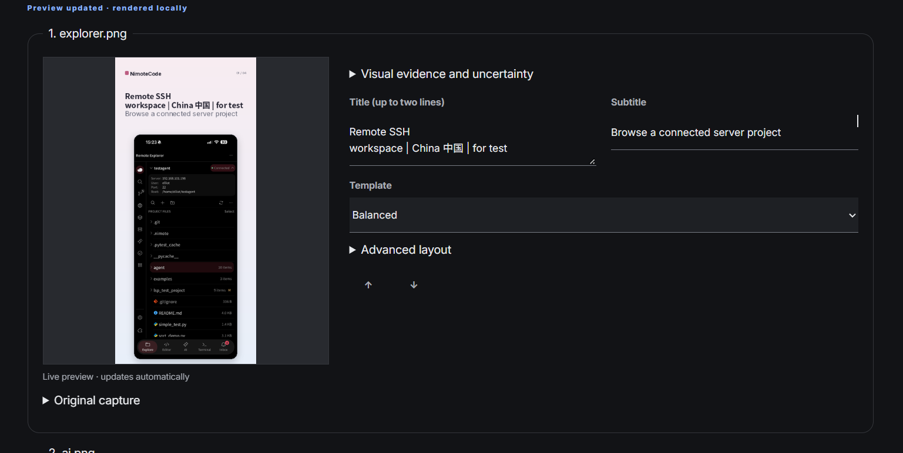
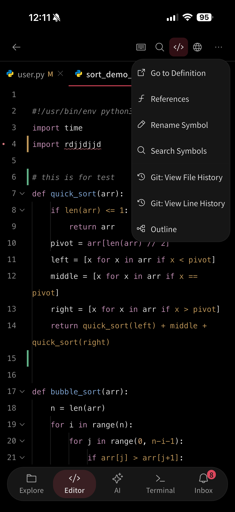
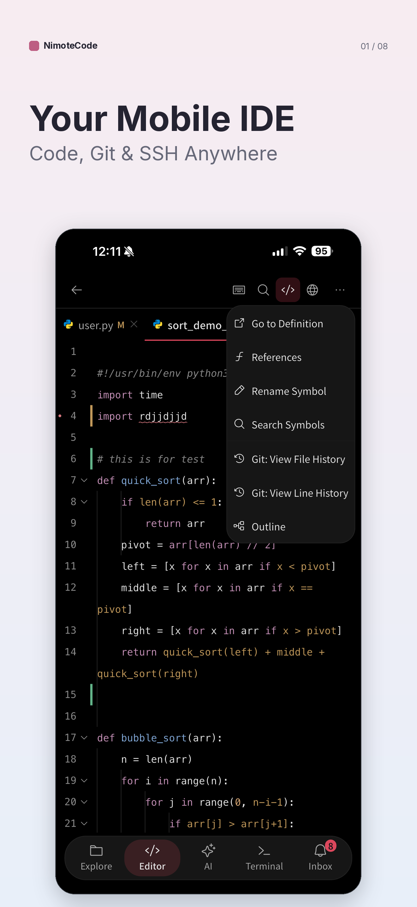

<p align="center">
  
</p>

# NimoteShot — Generador de capturas para App Store con IA

**Pantallas reales. Textos editables. Exportación PNG local.**

Convierte capturas de tu aplicación en imágenes para **App Store y Google Play**. Un modelo visual redacta el texto inicial; tú ajustas los textos y el diseño en un editor con vista previa y exportas imágenes para iPhone, iPad y Android. Para desarrolladores independientes y equipos que preparan su próximo lanzamiento.

**Python 3.11+ · Linux / macOS / Windows · 17 idiomas de salida · AGPLv3+**

[English](README.md) · [简体中文](README.zh-CN.md) · [日本語](README.ja.md) · [한국어](README.ko.md) · Español



*Edita el título, subtítulo y diseño junto al resultado. Solo se actualizan las vistas afectadas, de forma local y sin otra llamada a la IA. La imagen muestra el editor en funcionamiento.*

## Por qué usar NimoteShot

- **Parte de tu producto real.** Sube PNG, JPEG o WebP. El modelo redacta textos basados en funciones visibles y las capturas originales forman la composición.
- **Conserva el control después de generar.** Ajusta textos, plantillas, colores y orden; comprueba la vista previa antes de exportar.
- **Prepara varios mercados y dispositivos.** Elige 17 versiones de idioma y seis combinaciones de dispositivo y orientación, con fuentes incluidas según los caracteres introducidos.
- **Trabaja a tu manera.** Usa la web o la CLI. El diseño manual no necesita clave API; el análisis con IA admite proveedores visuales locales y en la nube.

El software es gratuito y de código abierto. Los proveedores de modelos en la nube pueden cobrar por el uso de su API.

## Inicio rápido

Instala **Python 3.11 o posterior** y clona el repositorio:

```bash
git clone https://github.com/mobiledevloperlab/nimoteshot.git
cd nimoteshot
```

Linux / macOS:

```bash
./install.sh
```

Windows PowerShell:

```powershell
powershell -ExecutionPolicy Bypass -File .\install.ps1
```

El instalador prepara `.venv`, instala las dependencias e inicia el estudio. Abre la **URL que aparece en el terminal**; la predeterminada es `http://127.0.0.1:8765`. Elige **Manual design** para probar el editor sin una clave de modelo.

## De la captura a la imagen de tienda

1. Introduce el nombre y una descripción o web HTTPS pública. Añade entre 1 y 40 capturas reales.
2. Elige idiomas, tamaños y dirección visual. Inicia el análisis con IA o el diseño manual.
3. Edita cada versión de idioma y comprueba la vista previa. Los cambios individuales actualizan las capturas afectadas; los ajustes globales renuevan el conjunto de vistas actual.
4. Usa **Export PNG / ZIP** para descargar imágenes RGB/sRGB validadas en varias resoluciones y una configuración editable.

| Captura original de la aplicación | Imagen de tienda generada |
| --- | --- |
|  |  |

[Explora la demostración completa](demo/nimotecode/). Los ajustes opcionales agrupan la reescritura de textos, la selección local de plantillas y el nuevo análisis de imágenes, indicando qué sustituye cada acción.

## Idiomas y fuentes

La selección de salida, el selector de versión, las instrucciones a la IA, la vista previa y la exportación usan el mismo catálogo de **17 idiomas**: inglés, chino simplificado y tradicional, japonés, coreano, español, francés, alemán, portugués brasileño, ruso, griego, vietnamita, árabe, hindi, bengalí, tailandés y hebreo. El inglés siempre se incluye; selecciona los demás según tus necesidades.

Cada idioma conserva sus propios textos. Las fuentes se eligen por los caracteres introducidos, de modo que un campo de inglés también puede contener chino o japonés. Los idiomas añadidos después de planificar empiezan con textos provisionales y un aviso para editarlos o regenerarlos. La composición del método de entrada termina antes de actualizar la vista previa.

La interfaz está disponible en inglés, chino simplificado, japonés, coreano y español. Las combinaciones de caracteres no cubiertas por las fuentes o la falta de composición de escritura compleja producen un error claro.

Algunas instalaciones de Pillow en macOS / Windows necesitan configurar FriBiDi por separado para escrituras complejas. Los idiomas no disponibles se desactivan en el selector con un enlace de configuración; el inglés, chino, japonés, coreano y otras escrituras compatibles siguen funcionando. Consulta [la guía de Pillow](https://pillow.readthedocs.io/en/stable/installation/building-from-source.html) y reinicia después de activar el soporte.

## Formatos, modelos y CLI

Incluye iPhone, iPad y Android en vertical y horizontal, cuatro estilos base, 24 paletas por categoría y plantillas editables. Cada tarea conserva originales, manifiesto SHA-256, configuración, vistas previas, PNG y ZIP en `store_screenshots/runs/<task-id>/`. Consulta los [tamaños de salida](store_screenshots/targets.json).

Puedes elegir DeepSeek (predeterminado), Qwen, GLM, Volcengine Ark, Hunyuan, APIs compatibles con OpenAI, Gemini, Claude, Ollama o la integración con Codex CLI. Analizar capturas requiere un modelo visual y acceso a él. Consulta la [configuración de proveedores](docs/PROVIDERS.md) y la [guía de CLI](README.md#cli).

## Actualizaciones y privacidad

Después de actualizar, ejecuta `python -m pip install -r store_screenshots/requirements.txt` y reinicia el servicio. Si el puerto está ocupado, una instancia verificada e inactiva del proyecto se cierra normalmente y se reemplaza. Las tareas activas y otros programas se mantienen; el nuevo estudio elige otro puerto e indica la URL real. No se fuerzan cierres de procesos.

El renderizado permanece en tu equipo, pero **el análisis con IA envía capturas y contexto al proveedor elegido**. Las claves guardadas se conservan en texto plano en la configuración del usuario. Usa imágenes que tengas derecho a enviar y revisa textos y traducciones antes de publicar. Consulta la [política de seguridad](.github/SECURITY.md) para conocer los límites y comunicar vulnerabilidades en privado.

## Construyámoslo juntos

Prueba el proyecto con tu aplicación y [comunica un problema reproducible](https://github.com/mobiledevloperlab/nimoteshot/issues/new/choose), mejora una traducción, fuente o plantilla, o envía un PR de código o documentación. Comenta los cambios grandes en un Issue primero. La [guía de contribución](.github/CONTRIBUTING.md) explica el entorno y las pruebas; las [notas de arquitectura y validación](docs/VISION_UPGRADE.md) recogen los detalles técnicos.

## Licencia

Se publica bajo [GNU AGPLv3 o posterior](LICENSE). Puedes usar, estudiar, modificar y compartir el proyecto según sus condiciones. Si ofreces una versión modificada como servicio de red, proporciona el código fuente correspondiente según la licencia. Las fuentes y otros materiales conservan sus propias licencias: consulta los [avisos de terceros](docs/THIRD_PARTY_NOTICES.md), el [código de conducta](.github/CODE_OF_CONDUCT.md) y la [gobernanza](docs/GOVERNANCE.md).
