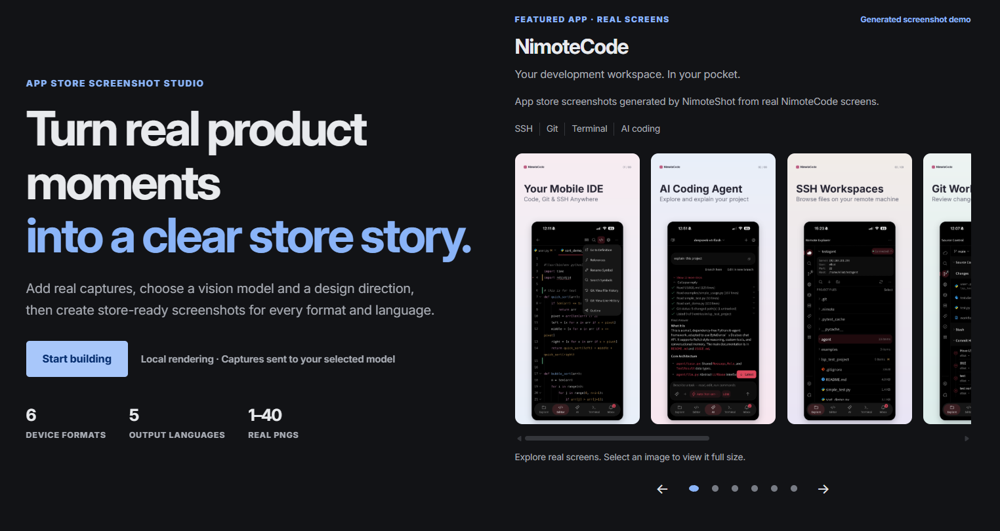
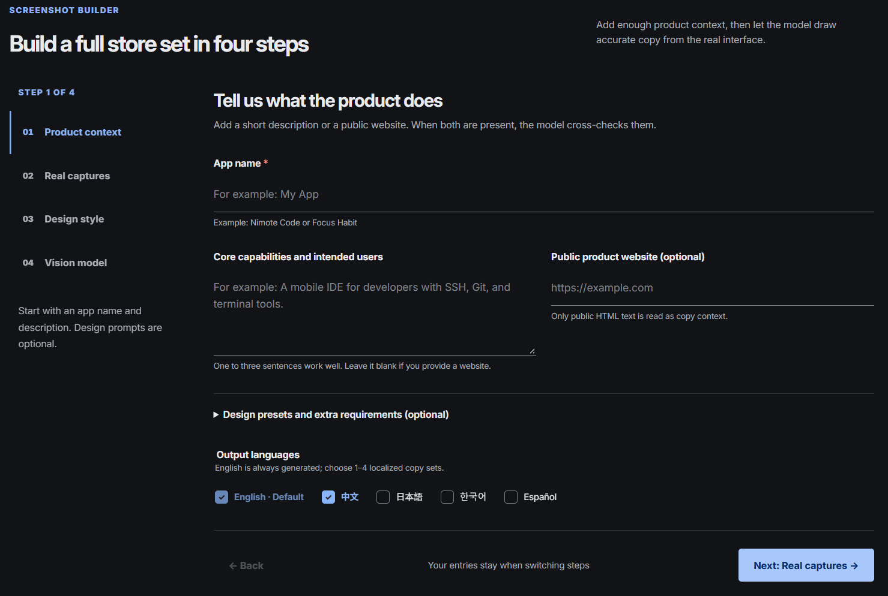
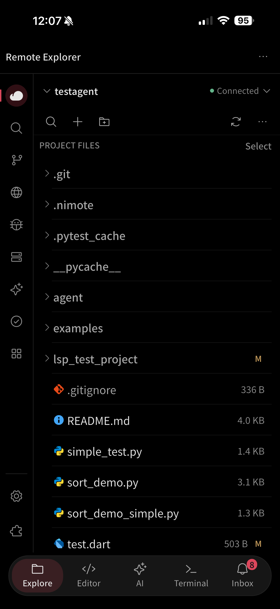
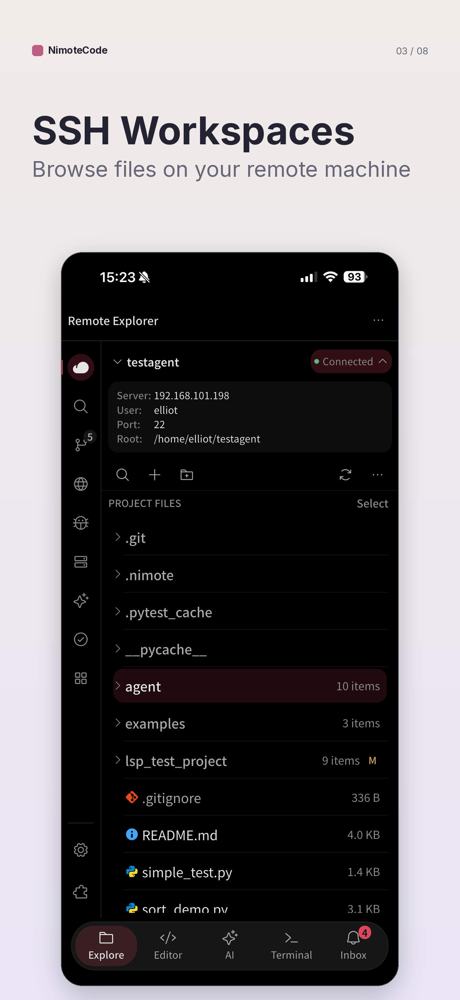
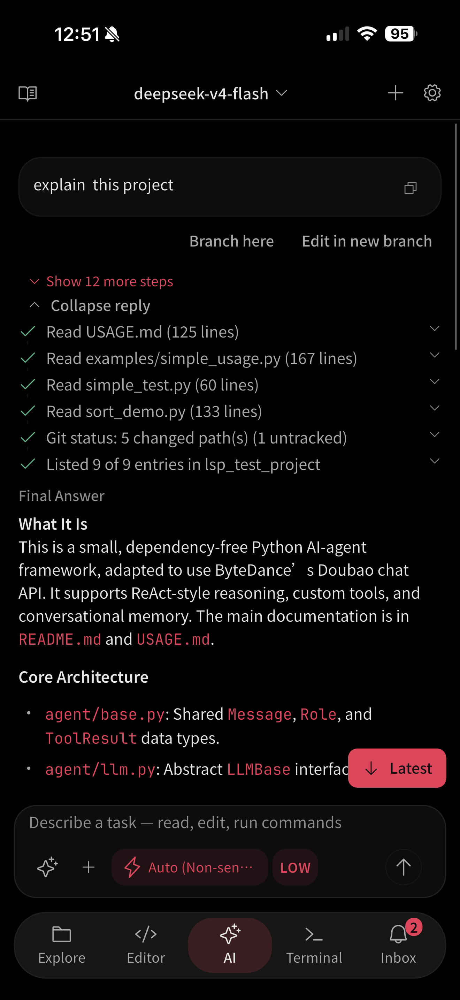
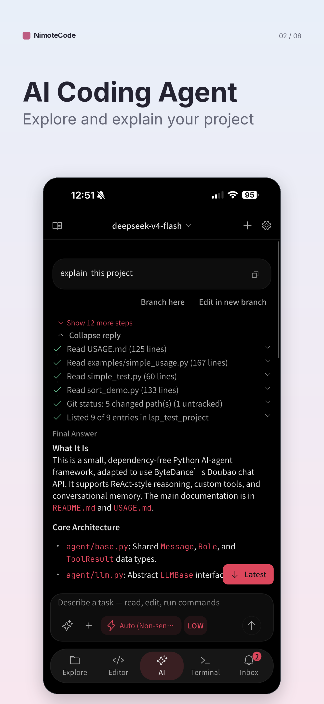

<p align="center">
  
</p>

<p align="center">
  
</p>

<p align="center"><strong>免费 AI App Store 与 Google Play 截图生成器</strong></p>

<p align="center">
  <a href="README.md">English</a> · 简体中文 · <a href="README.ja.md">日本語</a> · <a href="README.ko.md">한국어</a> · <a href="README.es.md">Español</a>
</p>

<p align="center">
  将真实产品界面截图转化为清晰、本地化、可用于 App Store 和 Google Play 上架的应用商店截图。
</p>

<p align="center"><em>真实 PNG、JPEG、WebP 截图&nbsp;&nbsp;•&nbsp;&nbsp;视觉模型辅助文案&nbsp;&nbsp;•&nbsp;&nbsp;本地渲染与导出</em></p>

<p align="center">
  <a href="#快速开始">快速开始</a> · <a href="#前后对比">前后对比</a> · <a href="#服务商">服务商</a> · <a href="#命令行使用">命令行</a> · <a href="demo/nimotecode/">示例</a>
</p>

<p align="center">
  完全开源 · 免费使用、修改与分享 · <a href="LICENSE">GNU AGPLv3</a> · <a href=".github/SECURITY.md">安全策略</a>
</p>

---

NimoteShot 是免费、开源的 AI 应用商店截图生成器，面向 App Store 和 Google Play 上架素材。它将真实 PNG、JPEG 或 WebP 界面交给你选择的视觉模型分析并起草本地化文案，同时在本机完成排版渲染与导出。每项任务都会生成可编辑的目录，包含原始截图、清单、配置、预览、成品与 ZIP 压缩包。

## 快速开始

克隆仓库后，在仓库目录运行安装脚本。应用本身免费开源；云端服务商可能需要单独的 API 访问权限，也可选择本地 Ollama 模型。

### Linux 与 macOS

```bash
git clone https://github.com/mobiledevloperlab/nimoteshot.git nimoteshot
cd nimoteshot
./install.sh
```

### Windows PowerShell

```powershell
git clone https://github.com/mobiledevloperlab/nimoteshot.git nimoteshot
cd nimoteshot
powershell -ExecutionPolicy Bypass -File .\install.ps1
```

打开命令行输出的 `http://127.0.0.1:8765` 地址。服务仅绑定本机回环地址。

## 前后对比

<table>
  <tr>
    <td width="56%" valign="top">
      
      <p align="center"><sub>首页与一组已生成的应用商店截图示例</sub></p>
    </td>
    <td width="44%" valign="top">
      
      <p align="center"><sub>四步式本地生成流程</sub></p>
    </td>
  </tr>
</table>

### 真实界面 → 上架素材

<table>
  <tr>
    <td width="33.33%" align="center" valign="top">
      <strong>移动代码编辑器</strong><br><br>
      
      <br>
      <sub>原始界面 → 生成的功能页素材</sub>
    </td>
    <td width="33.33%" align="center" valign="top">
      <strong>SSH 工作区</strong><br><br>
      
      <br>
      <sub>原始界面 → 生成的功能页素材</sub>
    </td>
    <td width="33.33%" align="center" valign="top">
      <strong>AI 编程助手</strong><br><br>
      
      <br>
      <sub>原始界面 → 生成的功能页素材</sub>
    </td>
  </tr>
</table>

## 为什么选择 NimoteShot

- **以真实界面为依据：** 每个任务保留原图，并记录 SHA-256 清单；它不是凭空生成界面模型的工具。
- **AI 分析，本地渲染：** 所选模型分析截图并起草文案，布局、PNG 渲染、打包和导出均在你的电脑完成。
- **可编辑的本地化：** 固定输出英文，并可选中文、日文、韩文、西班牙文；导出前可审阅和修改文案。

## 功能特性

- 基于 1–40 张真实 PNG、JPEG 或 WebP 界面截图生成素材，文案以界面内容为依据。
- 固定生成英文，并可选中文、日文、韩文、西班牙文。
- 支持 iPhone、Android、iPad 的竖屏与横屏目标尺寸。
- 提供 4 套基础视觉风格、24 套按应用类别划分的配色，以及可选设计提示词。
- 默认使用 DeepSeek Flash，支持通义、智谱 GLM、火山方舟、腾讯混元、OpenAI 兼容接口、Gemini、Claude、Ollama，以及已登录的 Codex CLI。
- 可通过仅监听本机回环地址的网页工作台或命令行使用；无需 Node.js 构建流程。
- 每次导出均保存 SHA-256 源文件清单和可编辑配置。

## 运行环境与服务商

| 组件 | 版本 / 访问要求 | 用途 |
| --- | --- | --- |
| 操作系统 | Linux、macOS 或 Windows 10/11 | 运行本地工作台和渲染器。 |
| Python | **3.11 或更高版本** | Pillow 13 与项目脚本的必需版本。 |
| pip + venv | 标准 Python 安装通常自带 | 创建隔离环境并安装依赖。 |
| 浏览器 | 现代桌面浏览器 | 访问 `http://127.0.0.1:8765` 本地工作台。 |
| 磁盘空间 | 至少 500 MB；大量导出时需要更多 | 存放虚拟环境、原图与生成的 PNG。 |
| 网络 | 安装依赖和使用云端模型时需要 | 排版渲染在本地完成；云服务商会接收分析输入。 |
| 视觉模型服务 | 受支持的 API Key、已配置 Endpoint、Ollama 或 Codex CLI 登录 | 分析截图并起草文案。 |

### 服务商

| 服务商 | 凭证或准备步骤 | 默认模型 / 说明 |
| --- | --- | --- |
| [DeepSeek](https://api-docs.deepseek.com/guides/vision/) | `DEEPSEEK_API_KEY` | DeepSeek Flash（默认） |
| [通义](https://help.aliyun.com/en/model-studio/qwen-api-via-dashscope) | `DASHSCOPE_API_KEY` | Qwen3-VL Plus |
| [智谱 GLM](https://docs.bigmodel.cn/cn/guide/develop/openai/introduction) | `ZAI_API_KEY` | GLM-5.3-Flash |
| 火山方舟 | `ARK_API_KEY` | 填写账户已开通的视觉模型或 Endpoint ID。 |
| [腾讯 TokenHub](https://cloud.tencent.com/document/product/1823/136956) | `HUNYUAN_API_KEY` | HY-Vision 2.0 Instruct |
| OpenAI 兼容接口 | `OPENAI_API_KEY` 或 `NIMOTESHOT_API_KEY` | 需要 HTTPS 基础地址与支持视觉的模型。 |
| Gemini / Claude | 对应服务商的 API Key | 在工作台中选择对应服务商。 |
| Ollama | 运行 `ollama serve`，并拉取视觉模型 | 例如 `ollama pull qwen3-vl:8b`；不需要云端 Key。 |
| Codex CLI | 安装 Codex CLI 后执行 `codex login` | 使用已登录账户，不会将 API Key 复制进 NimoteShot。 |

API 服务订阅与消费者聊天订阅不是同一项权限。开始生成前，请在服务商控制台确认账户有权调用所选视觉模型。

### 安装说明

安装脚本会检查 Python 3.11+、创建 `.venv`、安装运行依赖并打开工作台。Linux 或 macOS 如不希望自动打开浏览器：

```bash
./install.sh --no-browser
```

若企业安全策略限制 PowerShell，请联系管理员获得合规的执行策略；不要从不可信来源下载脚本。

### 手动安装

```bash
python -m venv .venv
# Linux/macOS
. .venv/bin/activate
# Windows PowerShell: .venv\Scripts\Activate.ps1
python -m pip install --upgrade pip
python -m pip install -r store_screenshots/requirements.txt
python scripts/nimoteshot.py web
```

在浏览器中打开输出的 `http://127.0.0.1:8765`。服务刻意只绑定本机回环地址，请勿通过反向代理、端口映射或共享主机将其公开到公网。

## 使用网页工作台

1. 输入应用名称，并填写简短产品说明或可信的公开 HTTPS 产品网站。
2. 上传 1–40 张真实 PNG、JPEG 或 WebP 界面截图。仅上传你有权发送给所选服务商的内容。
3. 选择目标语言、视觉风格、配色，以及可选的设计提示词。
4. 选择视觉模型服务商，先点击 **检查模型配置**，再开始生成。
5. 点击 **分析并生成方案**，按输出语言编辑文案，调整模板、品牌色和顺序。本地预览不重新调用 AI。
6. **重新生成文案** 复用视觉证据，无需重新发送图片；**重新推荐布局** 在本地完成；**重新分析截图** 会明确刷新视觉缓存。
7. 点击 **批量导出 PNG / ZIP** 获取校验后的多分辨率文件。没有密钥也可选择 **手动设计**，自行填写文案。

编辑器、模板选项、按钮和状态提示随五种界面语言切换；宣传文案的输出语言单独选择。默认优先突出单张真实界面，双图用于补充同一卖点，不强制拼图。详见[架构与验证记录](docs/VISION_UPGRADE.md)。

每次任务均保存到 `store_screenshots/runs/<任务ID>/`，其中包括原图、`source_manifest.json`、可编辑 `config.json`、预览、各尺寸 PNG 与 ZIP。修改配置后可重新渲染已有任务：

```bash
python scripts/generate_store_screenshots.py \
  --config store_screenshots/runs/<任务ID>/config.json --all
```

提交前请始终核对最新的 [Apple 截图规范](https://developer.apple.com/help/app-store-connect/reference/app-information/screenshot-specifications/) 和 [Google Play 图片要求](https://support.google.com/googleplay/android-developer/answer/9866151)。

## 命令行使用

将 PNG、JPEG 或 WebP 放入 `screens/`（该目录会被 Git 忽略），配置服务商后执行：

```bash
# 在上传截图前诊断服务商配置。
.venv/bin/python scripts/nimoteshot.py doctor --provider qwen

# 不回显密钥，保存本地配置档案。
.venv/bin/python scripts/nimoteshot.py configure \
  --provider qwen --prompt-api-key --verify

# 生成英文与中文导出。
.venv/bin/python scripts/nimoteshot.py generate \
  --brand "我的应用" \
  --description "面向开发者的移动编辑器，支持 SSH、Git 与终端" \
  --style editorial --provider qwen --locales zh-CN
```

Windows 请将 `.venv/bin/python` 替换为 `.venv\Scripts\python.exe`。完整参数可执行 `python scripts/nimoteshot.py --help` 查看，包括 `--website`、`--model`、`--base-url` 与 `--design-prompt`。

配置档案位于仓库外部：Linux/macOS 是 `~/.config/nimoteshot/config.json`，Windows 是 `%APPDATA%\NimoteShot\config.json`。Unix 上文件仅当前用户可读写，但密钥仍以明文落盘；请使用受加密保护的用户账户，并在泄露后轮换密钥。

## 隐私与安全

- 排版、打包和导出均在本地完成；截图和产品描述会发送到你选择的模型服务商进行分析。
- 填写产品网站会发起一次外部 HTTPS 请求，仅应使用可信的公开网站。
- 任务目录包含原始截图和文案，应按私密数据处理，不再需要时及时删除。
- 模型输出属于不可信输入；发布前必须审核所有文案、功能声明、翻译和设备映射。
- 不要提交 API Key、本地配置、私密截图、生成任务或压缩包。项目 `.gitignore` 已排除这些路径。

完整威胁模型和私密漏洞报告方式请见 [SECURITY.md](.github/SECURITY.md)。

## 开发与测试

```bash
python -m venv .venv
. .venv/bin/activate
python -m pip install -r requirements-dev.txt
python -m ruff check .
python scripts/run_tests.py
python scripts/check_repository.py
python scripts/check_secrets.py --history
```

测试会模拟服务商调用，不需要付费模型账户或真实 API Key。编码规范、测试要求与 Pull Request 流程请见[贡献指南](.github/CONTRIBUTING.md)。

## 项目结构

```text
nimoteshot/          核心流程、服务商适配、配置和本地服务
web/                 由本地 Python 服务提供的浏览器界面与公共素材
scripts/             CLI 入口、渲染器和仓库检查工具
store_screenshots/   目标尺寸定义、字体、色彩配置与生成任务
demo/nimotecode/     已审计的演示原图与示例产物
tests/               单元测试与安全测试
```

## 常见问题

| 现象 | 可能原因 | 解决方法 |
| --- | --- | --- |
| 提示 `Python 3.11 or newer is required` | `python` 命令指向较旧解释器。 | 安装 Python 3.11+，删除并重新创建 `.venv`；必要时显式使用 `python3.11`。 |
| 提示无法创建虚拟环境或 `No module named venv` | Python 未安装虚拟环境支持。 | 安装系统对应的 Python venv 组件后重新运行安装脚本。 |
| `Address already in use` | 8765 端口被占用。 | 执行 `python scripts/nimoteshot.py web --port 8766`，并打开命令行输出的地址。 |
| 无法从另一台电脑打开页面 | 工作台设计上只接受本机回环地址。 | 请在运行程序的电脑上使用；不要将其公开到公网。 |
| 检查模型配置时提示密钥或模型被拒绝 | Key 无权限、已失效，或模型 ID 不正确。 | 在服务商控制台确认权限，选择已开通的视觉模型，再执行 `doctor`。 |
| OpenAI 兼容接口校验失败 | Endpoint 不是 HTTPS，或基础地址/模型配置错误。 | 使用服务商提供的 HTTPS API 基础地址及支持视觉的模型 ID。 |
| Ollama 未就绪 | 本地服务或所选模型未启动。 | 先运行 `ollama serve`，再执行 `ollama pull qwen3-vl:8b`（或选定模型）。 |
| 提示 `Codex CLI was not found` | 未安装 Codex CLI，或命令不在 `PATH` 中。 | 安装 CLI，在终端执行 `codex login`，然后重新检查配置。 |
| 上传后生成失败 | 图片无效、服务商请求失败，或模型未返回合法 JSON。 | 使用有效截图，检查服务商配置后重试，或切换手动设计。 |
| 生成的文案不准确 | 模型可能误读界面或编造功能。 | 编辑任务配置并重新渲染；上架前人工核查每一项功能声明。 |

## 贡献与授权

欢迎通过 Fork 和 Pull Request 参与贡献。请阅读[贡献指南](.github/CONTRIBUTING.md)、[行为准则](.github/CODE_OF_CONDUCT.md)和[治理规范](docs/GOVERNANCE.md)；发版流程见 [docs/RELEASING.md](docs/RELEASING.md)。

NimoteShot 是完全开源、免费使用的软件，采用 [GNU Affero General Public License v3.0 或更高版本](LICENSE)（AGPLv3+）。你可以免费使用、学习、修改与分享本项目；如果将修改版作为网络服务提供给用户，必须以相同许可证向这些用户提供对应源码。打包字体和其他第三方材料继续遵守其各自条款，详见[第三方声明](docs/THIRD_PARTY_NOTICES.md)。
